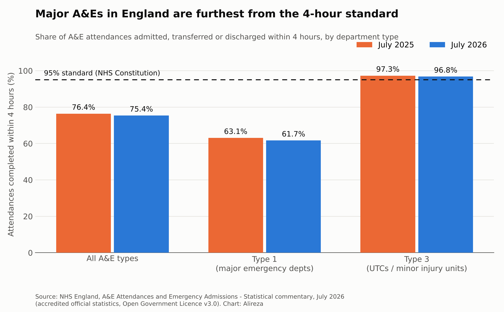

# NHS England A&E 4-hour performance charts

Charts of how many A&E attendances in England are admitted, transferred or discharged within 4 hours, split by department type, against the 95% NHS Constitution standard.



**Headline (July 2026):** major emergency departments (Type 1) completed 61.7% of attendances within 4 hours, down from 63.1% a year earlier. Urgent treatment centres and minor injury units (Type 3) stayed above the 95% standard at 96.8%. Across all A&E types the figure was 75.4%.

## Contents

| Script | What it makes |
|---|---|
| `scripts/ae_bar_july2026.py` | Bar chart comparing July 2025 and July 2026 by department type (figures typed in from the NHS England statistical commentary). |
| `scripts/ae_timeseries.py` | Monthly line chart of Type 1, Type 3 and all-types performance, read directly from NHS England's *Monthly A&E Time Series* spreadsheet. |

## Setup

```bash
git clone https://github.com/alirezaderavi/nhs-ae-4hour-charts.git
cd nhs-ae-4hour-charts
python -m venv .venv && source .venv/bin/activate   # Windows: .venv\Scripts\activate
pip install -r requirements.txt
```

## Usage

**Bar chart (no download needed):**

```bash
python scripts/ae_bar_july2026.py
# -> figures/ae_4hour_july2026.png
```

**Time series:**

1. Download *Monthly A&E Time Series* from the [NHS England A&E waiting times page](https://www.england.nhs.uk/statistics/statistical-work-areas/ae-waiting-times-and-activity/) and save it in `data/`.
2. Run:

```bash
python scripts/ae_timeseries.py data/Monthly-AE-Time-Series-<Month>-2026.xls
# options: --start 2015-01-01   -o figures/my_chart.png
```

The script finds the header row and the 4-hour percentage columns by name, so it copes with small layout changes between releases. It prints the columns it picked; check them before quoting any number.

## Department types

- **Type 1**: consultant-led, 24-hour major emergency departments with full resuscitation facilities.
- **Type 3**: urgent treatment centres, minor injury units and other walk-in services.
- **All types**: Types 1, 2 and 3 combined.

## Data source and licence

Data: NHS England, *A&E Attendances and Emergency Admissions* (accredited official statistics), published under the [Open Government Licence v3.0](https://www.nationalarchives.gov.uk/doc/open-government-licence/version/3/). The raw spreadsheets are not stored in this repository; download them from NHS England.

Code: MIT licence (see `LICENSE`).

## Author

Alireza, health data scientist (MSc Health Data Science, Swansea University).
